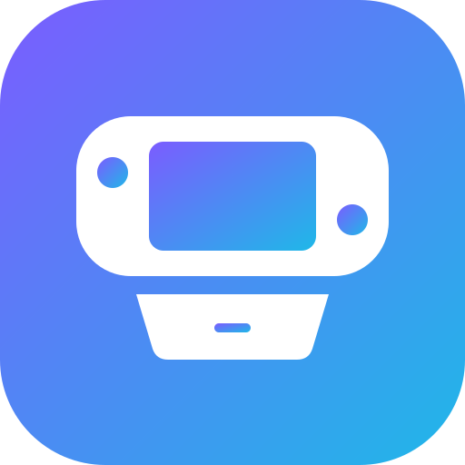

<div align="center">
  
  <h1>GameDock</h1>
  <p>A sua coleção de jogos de Nintendo Switch servida na sua rede, com a interface em português, inglês e espanhol.</p>
</div>

> **English:** GameDock is [Ownfoil](https://github.com/a1ex4/ownfoil) with a multi-language interface (English, Portuguese, Spanish). It follows every official Ownfoil release automatically. Use the image `ghcr.io/guslma/gamedock` in place of `a1ex4/ownfoil`.

## O que é

O GameDock organiza os seus jogos de Nintendo Switch e os serve na rede para o Tinfoil, o Sphaira e outros clientes: biblioteca com capas, verificação dos arquivos, compressão, organização automática e estatísticas.

Ele é baseado no [Ownfoil](https://github.com/a1ex4/ownfoil) e funciona igual a ele. As diferenças são o nome, a interface em vários idiomas e alguns recursos a mais:

- **Idioma automático:** cada pessoa vê o idioma do próprio navegador.
- **Seletor no menu:** dá para trocar de idioma a qualquer momento, e a escolha fica salva no navegador.
- **Edição de usuários:** em **Admin → Configurações**, o botão de lápis de cada usuário (desativado no Ownfoil) permite mudar o nome, a senha e as permissões.
- **Sempre atualizado:** todo dia uma verificação confere se saiu versão nova do Ownfoil. Quando sai, a imagem do GameDock dessa versão é gerada e publicada sozinha.

## Como instalar

Funciona em qualquer máquina Linux com Docker, como um mini PC, um NAS ou um Raspberry Pi.

```bash
sudo docker run -d --name gamedock \
  -p 8465:8465 \
  -e USER_ADMIN_NAME=admin \
  -e USER_ADMIN_PASSWORD=troque-esta-senha \
  -v /caminho/dos/jogos:/games \
  -v ~/gamedock/config:/app/config \
  -v ~/gamedock/data:/app/data \
  --restart unless-stopped \
  ghcr.io/guslma/gamedock:latest
```

Depois, abra `http://IP-DA-MÁQUINA:8465` no navegador. A imagem funciona em computadores comuns (amd64) e em ARM (arm64 e armv7).

Com Docker Compose:

```yaml
services:
  gamedock:
    image: ghcr.io/guslma/gamedock:latest
    container_name: gamedock
    ports:
      - 8465:8465
    environment:
      USER_ADMIN_NAME: admin
      USER_ADMIN_PASSWORD: troque-esta-senha
      # Idioma para quem não escolheu nenhum e usa um navegador num idioma sem tradução
      GAMEDOCK_LANGUAGE: pt-BR
    volumes:
      - /caminho/dos/jogos:/games
      - ./config:/app/config
      - ./data:/app/data
    restart: unless-stopped
```

### Vindo do Ownfoil

Troque a imagem `a1ex4/ownfoil` por `ghcr.io/guslma/gamedock` e mantenha as mesmas pastas `config` e `data`: a biblioteca, os usuários e as configurações continuam como estavam. Se o nome da loja estiver como "Ownfoil", mude em **Admin → Configurações → Loja**.

No Sphaira, o menu continua se chamando **Ownfoil**, porque esse é o nome que o próprio Sphaira mostra.

### Atualizar

```bash
sudo docker pull ghcr.io/guslma/gamedock:latest
sudo docker rm -f gamedock
```

Depois, rode de novo o comando de instalação. Para fixar uma versão, use a tag dela, como `ghcr.io/guslma/gamedock:2.5.0`. As tags seguem as versões do Ownfoil.

## Como funciona

A imagem parte da oficial (`a1ex4/ownfoil`) e muda só a interface:

- [`locales/`](locales) tem um arquivo por idioma, com o texto original em inglês e a tradução.
- [`build/translate.py`](build/translate.py) aplica as traduções nas páginas e nos scripts. Ele troca apenas textos inteiros e deixa intactos os valores que o código compara, então um texto que o dicionário não conhece continua em inglês, sem quebrar nada.
- [`build/build.py`](build/build.py) gera uma cópia das páginas para cada idioma, troca o nome para GameDock e adiciona o seletor de idioma. Se uma versão nova do Ownfoil mudar algum ponto que ele altera, a geração da imagem para com um erro, em vez de publicar uma imagem pela metade.
- [`build/gamedock_i18n.py`](build/gamedock_i18n.py) escolhe o idioma de cada acesso.

Os textos que ficaram sem tradução aparecem no resumo de cada execução em **Actions**.

### Adicionar um idioma

1. Liste os textos de uma instalação do GameDock ou do Ownfoil:

   ```bash
   python3 build/translate.py /pasta/do/app textos.json
   ```

2. Copie `locales/es.json` para `locales/<código>.json` (por exemplo, `fr.json` ou `de.json`), troque `@name` pelo nome do idioma e traduza os valores. Os textos com `{{ }}` ou `` precisam manter esses trechos iguais, e as traduções não podem ter aspas.
3. Envie o arquivo. A imagem nova já sai com o idioma no menu.

## Créditos e licença

O GameDock é baseado no [Ownfoil](https://github.com/a1ex4/ownfoil), de a1ex4, e distribuído sob a mesma licença, a AGPL-3.0. Veja o arquivo [`LICENSE`](LICENSE).
